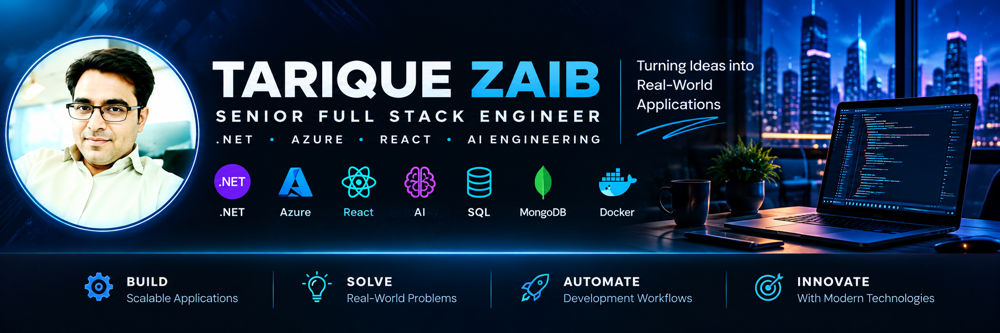

  

# 👋 Hi, I'm Tarique Zaib

### `Senior Full Stack Engineer` · `.NET & Azure` · `AI Engineering`

**I turn complex business requirements into maintainable software, secure APIs, and modern full-stack applications.**

---

## ⚡ Engineering Focus

- 🏗️ **Backend:** C#, .NET, ASP.NET Core, Web APIs, Entity Framework Core
- 🎨 **Frontend:** React, TypeScript, Angular, Blazor
- ☁️ **Cloud & DevOps:** Azure, Azure Functions, Azure Service Bus, Azure DevOps, CI/CD
- 🗄️ **Data:** SQL Server, PostgreSQL, MongoDB
- 🧩 **Architecture:** Clean Architecture, microservices, API design
- 🤖 **AI:** Local LLMs, AI-assisted workflows, intelligent applications

## 🚀 Featured Projects

| Project | What I'm building |
|---|---|
| [⚖️ DraftLex](https://github.com/tarique-zaib/DraftLex) | Legal drafting and workflow application |
| [🎓 ProgressiveMinds](https://github.com/tarique-zaib/Progressiveminds) | Coaching institute management platform |
| [📊 Migsun Sales Intelligence AI](https://github.com/tarique-zaib/MigsunSalesIntelligenceAI) | Independent sales intelligence prototype |
| [🧠 EchoAI](https://github.com/tarique-zaib/EchoAI) | AI-focused application project |
| [🤝 TalentBridgeSearch](https://github.com/tarique-zaib/TalentBridgeSearch) | IT recruitment platform concept |
| [💡 SkillSwap](https://github.com/tarique-zaib/SkillSwap) | Skills-sharing application project |

## 🛠️ Technology Stack & Engineering Expertise

My engineering toolkit spans enterprise application development, modern web technologies, cloud platforms, distributed systems, data engineering, software architecture, DevOps, and AI-assisted applications. I focus on selecting the right technologies for maintainability, security, performance, and business value.

### 💻 1. Programming Languages & Core Development

I use strongly typed and dynamic languages to develop enterprise applications, implement business logic, integrate systems, and build responsive web experiences.

**Technologies:** C#, VB.NET, JavaScript, TypeScript, SQL, HTML5, CSS3, JSON, XML, PowerShell.

**Engineering concepts:** Object-oriented programming (OOP), SOLID principles, asynchronous programming, generics, delegates, events, exception handling, collections, LINQ, and reusable components.

### ⚙️ 2. Backend Engineering & Microsoft Technologies

I build APIs and backend services with an emphasis on separation of concerns, secure request processing, reusable business logic, and reliable data access.

**Technologies and frameworks:**
- C#, .NET, .NET Core, .NET 8, ASP.NET Core
- ASP.NET Core Web API and RESTful API design
- Entity Framework and Entity Framework Core
- LINQ, dependency injection, middleware, and configuration
- Authentication and authorization with JWT bearer tokens
- Blazor and SignalR where appropriate

**Engineering concepts:** API versioning, request validation, exception handling, logging, pagination, filtering, service-layer design, and integration with external systems.

### 🎨 3. Frontend Engineering & UI Development

I develop web interfaces that integrate with backend APIs and support clear, responsive user workflows. I focus on reusable components, typed application code, maintainable state management, and consistent user experiences.

**Technologies and frameworks:**
- React, React Hooks, TypeScript, JavaScript
- Angular, components, services, routing, and forms
- Blazor for .NET-based interactive UI
- Vite, HTML5, CSS3, responsive design
- Bootstrap and Tailwind CSS where used
- Lucide React for interface icons

**Engineering concepts:** Component architecture, API integration, form validation, loading and error states, accessibility, responsive layouts, and frontend build optimization.

### ☁️ 4. Cloud Computing & Azure

I design applications with cloud integration, secure configuration, deployment, and operational reliability in mind. Cloud services should solve concrete needs such as background execution, messaging, secrets management, and application hosting.

**Technologies and services:**
- Microsoft Azure
- Azure App Service and Azure Functions
- Azure Service Bus
- Azure Key Vault
- Azure DevOps
- Application configuration and environment management
- Cloud-hosted APIs and application deployment

**Engineering concepts:** Managed configuration, identity and access management, asynchronous processing, environment separation, secret management, monitoring, and deployment automation.

### 🗄️ 5. Databases, Persistence & Data Access

I work with relational and document databases to support business applications, reporting, transactional workflows, and structured data management.

**Technologies:**
- Microsoft SQL Server and T-SQL
- PostgreSQL
- MongoDB
- Entity Framework and Entity Framework Core
- Npgsql for PostgreSQL integration
- Database schema design, relationships, indexes, and migrations

**Engineering concepts:** Normalization, query optimization, transactions, data integrity, pagination, indexing strategies, ORM mapping, schema evolution, and efficient database access.

### 🏗️ 6. Software Architecture & Enterprise Design

I approach architecture as a way to control complexity, establish clear boundaries, improve testability, and support long-term evolution. Architectural decisions should be driven by requirements and trade-offs rather than trends.

**Architectural patterns and practices:**
- Clean Architecture
- Layered and modular architecture
- Microservices and service-oriented design
- Domain-Driven Design (DDD)
- SOLID principles and dependency inversion
- Separation of concerns
- RESTful APIs and integration contracts
- TOGAF and enterprise architecture principles

**Engineering concepts:** Bounded contexts, dependency management, domain modeling, extensibility, resilience, maintainability, and balancing distributed-system complexity against business needs.

### 🔄 7. Messaging, Integration & Distributed Systems

I explore asynchronous communication and event-driven patterns for systems that need to decouple producers and consumers, process background work, or integrate independent services.

**Technologies:**
- Apache Kafka
- Azure Service Bus
- REST APIs and HTTP-based integration
- Background services and scheduled processing
- JSON-based message contracts

**Engineering concepts:** Producers and consumers, event-driven workflows, retries, idempotency, error handling, message contracts, and eventual consistency.

### 🤖 8. Artificial Intelligence & Intelligent Applications

I experiment with practical AI integrations and local language models to explore how intelligent capabilities can support real application workflows.

**Technologies and tools:**
- Ollama for running local language models
- Qwen model family for local experimentation
- Prompt-driven application workflows
- AI-assisted development tools
- API integration for AI-enabled features
- Rule-based decision engines for deterministic business logic

**Engineering concepts:** Prompt design, structured outputs, input validation, model failure handling, privacy considerations, latency, and distinguishing deterministic business rules from generated AI content.

AI features should be evaluated for accuracy, reliability, cost, and suitability for the task. A rule-based score should not be described as a trained predictive model.

### 🚀 9. DevOps, CI/CD & Automation

I use version control and automated validation to make changes repeatable, reduce manual errors, and identify issues earlier in the development lifecycle.

**Technologies and tools:**
- Git and GitHub
- GitHub Actions
- Azure DevOps pipelines
- Docker and container-based development
- npm and Node.js
- NuGet and .NET CLI
- PowerShell scripting
- Environment variables and application configuration

**Engineering concepts:** Branch-based workflows, pull requests, dependency restoration, production builds, CI checks, environment isolation, release preparation, and repeatable developer setup.

### 🧪 10. Testing, Quality & Troubleshooting

I focus on verifying application behavior, identifying defects systematically, and maintaining a reliable development workflow.

**Tools and practices:**
- Postman for API testing
- .NET build and test tooling
- TypeScript compiler checks
- Vite production builds
- Git diff and whitespace checks
- Dependency vulnerability auditing
- Structured logs and error analysis

**Engineering concepts:** Unit and integration testing, regression checks, input validation, error diagnosis, dependency review, build verification, and reproducible bug reports.

### 🛠️ 11. Development Environments & Productivity Tools

I use development tools to navigate codebases, troubleshoot builds, manage dependencies, and maintain a consistent local development environment.

**Tools:**
- Visual Studio
- Visual Studio Code
- GitHub
- Android Studio for Android development workflows
- PowerShell and Windows terminal tools
- npm, Node.js, .NET CLI, and Gradle

**Engineering concepts:** Local environment configuration, build troubleshooting, source control, dependency management, debugging, and repeatable setup instructions.

### 🎯 12. Engineering Principles

Across technologies and projects, I aim to apply the following principles:

- **Maintainability:** Keep code modular, readable, and testable.
- **Security:** Protect credentials, validate inputs, and apply least-privilege access.
- **Reliability:** Handle errors deliberately and design observable systems.
- **Scalability:** Select appropriate data, integration, and deployment patterns.
- **Pragmatism:** Match complexity to actual business requirements.
- **Continuous improvement:** Use code reviews, automated checks, and documentation to improve delivery.

> Technology badges and tool lists describe areas of experience or interest; they do not imply that every technology is used in every project.

## 📈 GitHub Activity

*Stats are generated by an external service and may occasionally be unavailable.*

## 🧭 How I Approach Engineering

- Design for maintainability, security, and testability.
- Keep business logic separate from infrastructure concerns.
- Automate builds and repetitive engineering tasks.
- Use AI pragmatically, with attention to reliability and security.
- Document technical decisions and make projects easier to run.

## 🤝 Let's Connect

I'm interested in meaningful engineering challenges involving .NET, Azure, full-stack development, software architecture, and practical AI applications.

**[Connect with me on LinkedIn](https://www.linkedin.com/in/tarique-zaib-35877a4/)** · **[Explore my repositories](https://github.com/tarique-zaib?tab=repositories)**

---

*Building thoughtfully. Learning continuously. Shipping responsibly.*
